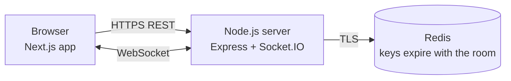

<div align="center">

# Blip

### Timed. Anonymous. Gone in a blip.

**Real-time rooms for chatting and coding together, with nothing left behind.**

<a href="https://blip-ten-iota.vercel.app"></a>


[Live demo](https://blip-ten-iota.vercel.app) · [Features](#features) · [Getting started](#getting-started) · [Deployment](DEPLOYMENT.md)

</div>

---

## About

Blip lets anyone open a room in seconds, without signing up, and collaborate through live chat and a shared code editor. Every room has a timer. When it runs out, the room and everything in it (messages, files, code) is permanently deleted.

### Try it

1. Open **[blip-ten-iota.vercel.app](https://blip-ten-iota.vercel.app)** and click **Create Room**.
2. Click **Invite** in the room header and open the link in a second browser or a private window.
3. Chat, react, share a file or edit code together, and watch the timer count down.

> **First visit after a quiet period?** The backend runs on a free plan that sleeps when idle. If you see *"Waking up the server…"*, give it up to a minute.

---

## Contents

- [About](#about)
- [Features](#features)
- [How it works](#how-it-works)
- [Tech stack](#tech-stack)
- [Getting started](#getting-started)
- [Configuration](#configuration)
- [Deployment](#deployment)
- [Testing](#testing)
- [Security and privacy](#security-and-privacy)
- [Project structure](#project-structure)
- [API reference](#api-reference)
- [Known limitations](#known-limitations)
- [Roadmap](#roadmap)
- [License](#license)

---

## Features

**Rooms**
- **No accounts.** Each visitor gets a random display name and an anonymous identity.
- **Chat rooms** and **coding rooms**, with a 10, 20, 30 or 60 minute lifetime.
- **Private rooms** shared by room code or one-click invite link, with host controls to export a session snapshot and end the room early.
- **Public rooms** that anyone can join without a code. Two system rooms (`PUB10M`, `PUB20M`) restart automatically with a fresh name each cycle, and admins can add more.
- **Automatic deletion** when the timer ends, enforced by Redis key expiry, so data is removed even if the server is down at that moment.

**Chat**
- Replies, emoji reactions and typing indicators
- Image and file sharing (up to 3 MB per file)
- Voice notes with a live microphone level meter
- Link previews in a resizable side panel (YouTube, images and web pages)

**Coding**
- Shared Monaco editor (the editor behind VS Code) with live code sync
- Color-coded remote cursors and selections for each participant
- Shared language selection: JavaScript, TypeScript, Python, Java, C++, Go, Rust
- Problem-link sharing for practice sessions (LeetCode, GeeksforGeeks, Codeforces and similar)
- Optional code runner with custom input and test cases (disabled in production by default; see [Security](#security-and-privacy))

**Reliability**
- A host refresh or network blip doesn't end the room: the host gets a 45-second grace period, shown to everyone as a countdown.
- Clients reconnect and rejoin automatically after connection drops or server restarts.
- Room timers are rebuilt from Redis when the server starts.
- Responsive layout for desktop and mobile.

### Use cases

DSA practice groups, pair programming, timed mock interviews, classroom labs, hackathon team rooms, and quick help sessions where creating accounts would get in the way.

---

## How it works



1. Creating a room stores its metadata in Redis with a time-to-live equal to the room's lifetime.
2. Participants connect over Socket.IO. The server binds each connection to one room and one identity, and relays chat messages, reactions, editor changes and cursors to everyone else in that room.
3. Every piece of room data (messages, reactions, files, code) is written with the same expiry. An in-memory timer tells connected clients the moment the room ends; Redis expiry guarantees the data is gone even if that timer never fires.

---

## Tech stack

| Layer | Technology |
| --- | --- |
| Frontend | Next.js 14 (Pages Router), React 18, Tailwind CSS |
| Editor | Monaco via `@monaco-editor/react` |
| Real-time | Socket.IO 4 |
| Backend | Node.js 22, Express 4 |
| Data | Redis (local or Upstash) |
| Hosting | Vercel (frontend), Render (backend), Upstash (Redis) |

---

## Getting started

### Prerequisites

- **Node.js 22** (18.18+ works for the frontend)
- **Redis**: a local `redis-server`, Docker, or a free Upstash database

### 1. Clone and install

```bash
git clone https://github.com/Sneh5824/Blip.git
cd Blip

cd backend && npm install
cd ../frontend && npm install
cd ..
```

### 2. Start Redis

```bash
docker compose up -d      # uses docker-compose.yml
# or
redis-server
```

### 3. Configure (optional for local development)

Both apps work locally with no configuration. To change anything, copy the templates:

```bash
cp backend/.env.example backend/.env
cp frontend/.env.example frontend/.env.local
```

### 4. Run

In two terminals:

```bash
cd backend && npm run dev       # http://localhost:5001
cd frontend && npm run dev      # http://localhost:3000
```

Or both at once from the repository root (after `npm install` in the root):

```bash
npm run dev
```

Open http://localhost:3000, create a room, and open the invite link in a second browser or a private window to try it with two users.

---

## Configuration

### Backend: `backend/.env`

See [`backend/.env.example`](backend/.env.example) for a commented template.

| Variable | Default | Description |
| --- | --- | --- |
| `NODE_ENV` | unset | `production` turns on strict startup checks and proxy-aware rate limiting, and turns code execution off by default |
| `PORT` | `5001` | HTTP and WebSocket port (set automatically on Render) |
| `HOST` | `0.0.0.0` in production | Network interface to listen on |
| `REDIS_URL` | `redis://localhost:6379` | Redis connection; use `rediss://` (TLS) for Upstash. **Required in production.** |
| `FRONTEND_URL` | `http://localhost:3000` | Allowed frontend origin(s), comma-separated. **Required in production.** |
| `ADMIN_PASSWORD` | unset | Enables the `/admin` dashboard; leave unset to disable it |
| `CODE_EXECUTION` | on in development, off in production | Enables the code runner (`/api/run`) |
| `HOST_GRACE_MS` | `45000` | How long a room waits for a disconnected host |
| `ROOM_CREATE_LIMIT_PER_MIN` | `20` | Room creations allowed per IP per minute |
| `ROOM_ATTACHMENT_BUDGET_MB` | `20` | File storage allowed per room |
| `CODE_EXEC_MAX_CONCURRENT` | `4` | Code runs allowed at the same time |
| `CODE_FLUSH_MS` | `2000` | Maximum delay before editor content is saved to Redis |
| `TRUST_PROXY` | `1` in production | Number of proxies in front of the server |

In production, the server refuses to start if a required variable is missing or invalid, and logs the reason.

### Frontend: `frontend/.env.local`

| Variable | Default | Description |
| --- | --- | --- |
| `NEXT_PUBLIC_BACKEND_URL` | `http://localhost:5001` in development | Backend URL. **Required for production builds**; the Vercel build fails without it. It is public, so never put secrets in it. |

---

## Deployment

**Live:** [https://blip-ten-iota.vercel.app](https://blip-ten-iota.vercel.app)

Blip runs at no cost on free tiers:

| Part | Platform | Notes |
| --- | --- | --- |
| Frontend | Vercel (Hobby) | Root directory `frontend`; free for non-commercial use |
| Backend | Render (Free web service) | Configured by [`render.yaml`](render.yaml); sleeps after 15 idle minutes and takes about a minute to wake |
| Redis | Upstash (Free) | 256 MB storage, 500K commands per month |

Step-by-step instructions, the full list of environment variables, free-tier limits and a troubleshooting table are in **[DEPLOYMENT.md](DEPLOYMENT.md)**.

---

## Testing

The backend has an end-to-end test suite that starts the real server against Redis and exercises it over HTTP and Socket.IO. It covers:
- authorization and host controls
- the host grace period
- file uploads and downloads
- input validation
- concurrent reactions
- data expiry
- the code runner
- the admin API
- restart recovery
- production-mode checks: required settings, origin restrictions and rate limiting behind a proxy

```bash
redis-server --port 6390                     # a throwaway Redis instance
cd backend
TEST_REDIS_URL=redis://127.0.0.1:6390 npm test
```

The tests only create their own short-lived rooms and never wipe Redis, but use a separate instance anyway. The C++ test is skipped automatically when the machine's `g++` can't build programs.

---

## Security and privacy

- **No accounts and no personal data.** Display names are random; nothing outlives the room.
- **Identity is not spoofable.** Each browser holds a private ID that is only ever sent to the server. Other participants see a separate per-room public ID, so nobody can impersonate the host.
- **Server-side authorization.** After joining, every action is checked against the room and identity the server recorded, never against what the client claims. Only the host can end a private room or share problem links.
- **Input validation.** Messages, names, links (http/https only) and files are validated server-side. Files are served with headers that force downloads for anything except images and audio, and SVG is never displayed inline.
- **Abuse limits.** Rate limits on room creation, messages, files, reactions, code runs and admin logins, plus a per-room file storage budget.
- **Restricted origins.** In production the backend only accepts requests from the configured frontend address.
- **Code execution.** The runner uses timeouts, output limits, a separate temp folder per run and a stripped environment, and JavaScript/TypeScript run under Node's permission model. Python, Java and C++ still run without a full sandbox, so **the runner is off in production by default**. Only enable it on an isolated machine.

---

## Project structure

```text
.
├── backend/
│   ├── server.js            REST API, admin API, file downloads, startup and shutdown
│   ├── socket.js            Real-time events and server-side authorization
│   ├── sessionManager.js    Redis data layer (rooms, participants, messages, files, code)
│   ├── roomLifecycle.js     Expiry timers, host grace period, restart recovery, public rooms
│   ├── codeRunner.js        Time- and output-limited code execution
│   ├── config.js            Environment validation
│   ├── rateLimit.js         Rate limiting
│   └── test/                End-to-end tests
├── frontend/
│   ├── components/          Chat panel, code editor, participant list, timer, expiry screen
│   ├── lib/                 Socket client, identity, configuration, URL helpers
│   ├── pages/               Landing page, room page, admin dashboard
│   └── styles/
├── render.yaml              Render deployment configuration
├── docker-compose.yml       Local Redis
└── DEPLOYMENT.md            Deployment guide
```

---

## API reference

<details>
<summary><b>REST endpoints</b></summary>

| Method | Endpoint | Purpose |
| --- | --- | --- |
| `POST` | `/api/rooms` | Create a private room |
| `GET` | `/api/rooms/:roomId` | Room details (also used to check that a room exists) |
| `GET` | `/api/public-rooms` | List active public rooms |
| `GET` | `/api/rooms/:roomId/attachments/:id` | Download a shared file |
| `POST` | `/api/run` | Run code (participants of an active coding room only; off in production by default) |
| `GET` | `/health` | Health check, including Redis connection status |
| `POST` | `/api/admin/login` | Exchange the admin password for a 1-hour token |
| `GET` | `/api/admin/stats` | Active rooms, participants and messages |
| `GET` | `/api/admin/public-rooms` | List public rooms |
| `POST` | `/api/admin/public-rooms` | Create a public room |
| `DELETE` | `/api/admin/public-rooms/:roomId` | Remove a public room |

</details>

<details>
<summary><b>Socket.IO events</b></summary>

**Client → server**

| Event | Purpose |
| --- | --- |
| `join_room` | Join a room (sent again automatically after reconnecting) |
| `leave_room` | Leave the current room |
| `send_message` | Send a text message or file, optionally as a reply |
| `typing_status` | Typing indicator |
| `toggle_reaction` | Add or remove an emoji reaction |
| `code_update` | Shared editor content |
| `language_update` | Change the shared editor language |
| `cursor_update` | Cursor position and selection |
| `share_problem` | Share a problem link |
| `end_room` | End the room (host only) |

**Server → client**

| Event | Purpose |
| --- | --- |
| `room_joined` | Initial room state |
| `receive_message` | New message |
| `typing_update` | Typing indicator change |
| `reaction_updated` | Reaction change |
| `code_updated` / `language_updated` | Editor content or language changed |
| `cursor_updated` / `cursor_removed` | Remote cursor changes |
| `participants_update`, `user_joined`, `user_left` | Presence changes |
| `problem_shared` | Problem link changed |
| `host_status` | Host disconnected (with countdown) or reconnected |
| `room_expired` | Room ended and its data was deleted |
| `room_error` | Joining failed |
| `action_error` | An action was rejected (shown as a notice) |

</details>

<details>
<summary><b>Redis keys</b></summary>

Every room key expires together with the room.

| Key | Type | Contents |
| --- | --- | --- |
| `room:{id}` | String | Room metadata |
| `participants:{id}` | Hash | Current participants |
| `messages:{id}` | List | Chat history (last 300 messages) |
| `msgids:{id}` | Set | Message IDs, for validating reactions |
| `reactions:{id}` | Hash | Reactions per message |
| `code:{id}` | String | Shared editor content |
| `att:{id}:{fileId}` | String | Shared file contents |
| `atts:{id}` / `attbytes:{id}` | Set / String | File index and storage used |
| `rooms:expiry` | Sorted set | All rooms by expiry time (used to restore timers after a restart) |
| `rooms:public` | Sorted set | Public rooms |

</details>

---

## Known limitations

- **Simultaneous edits.** The editor syncs whole documents, so two people typing in the same instant can overwrite each other's latest keystrokes.
- **Cold starts.** On Render's free plan the backend sleeps after 15 idle minutes, and the first visitor afterwards waits about a minute. The app shows a notice while it wakes up.
- **Single server.** Timers, rate limits and admin sessions live in memory, which is fine for one instance. Running several instances would need the Socket.IO Redis adapter.
- **Free-tier quotas.** Heavy use can exhaust Upstash's monthly command allowance; messages then fail to send until the quota resets.
- **Link previews.** Some websites refuse to be shown inside another page; they open in a new tab instead.

---

## Roadmap

- Conflict-free collaborative editing with a CRDT library such as Yjs
- A container sandbox so the code runner can be enabled safely in production
- Moderation tools for public rooms: reporting, muting and spam filtering
- Room capacity limits with overflow rooms
- Moving users into the next cycle automatically when a public room restarts
- Optional verified rooms for organisations, alongside the anonymous default

---

## License

Built by **Sneh Patel** as a Semester 6 mini project. Available for academic and personal use.

<div align="center">

**[Open Blip →](https://blip-ten-iota.vercel.app)**

</div>
